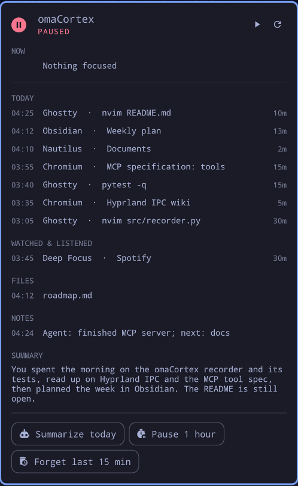

# omaCortex

A private, local memory of your day for [Omarchy](https://omarchy.org).

omaCortex keeps track of what you were doing on your computer: which windows
you worked in, what you watched and listened to, which pages you read and
which files you opened. It shows that in a bar panel ("Where was I?"), finds
the thing you half remember (`omacortex recall "that article about rates
last week"`), summarizes your day with a **local** model, and gives your AI
agents the same memory over **MCP**, so they stop asking you to repeat
yourself.

It is the operating-system counterpart of a browser memory extension: one
timeline across every app, kept on your machine.

<p align="center"></p>

## Privacy first

- **Off until you say so.** Nothing is recorded until you press *Start
  recording* or run `omacortex enable`.
- **Local only.** One SQLite database in `~/.local/share/omacortex/`, mode
  `0600`, directory `0700`. omaCortex makes no network connections except to
  a model server on `127.0.0.1`; any other model endpoint is refused unless
  you set `model.allow_remote = true`.
- **Metadata, not content.** It records the focused window's app and title,
  the title of what is playing, and the paths of files you open. If you
  connect a browser, also the title, site, author and address of the pages
  you read, never their text. It never takes screenshots, reads window
  contents, logs keystrokes or reads the clipboard.
- **Never recorded:** password managers (1Password, Bitwarden, KeePassXC,
  Proton Pass), pinentry and polkit prompts, private/incognito browser
  windows, sign-in, banking and 2FA pages, account, sign-in, bank and
  password-manager web sites, workspaces you exclude, and files under
  `~/.ssh`, `~/.gnupg`, `~/.password-store` or with key-like names. An
  excluded window leaves a gap; it is not stored under another name.
- **Scrubbed:** e-mail addresses, API tokens and long secrets, and URL query
  strings are removed from every title before it is stored.
- **You stay in control.** Pause from the bar (right-click), for an hour, or
  until you resume. *Forget last 15 min* in the panel, or
  `omacortex forget --app signal`, `--since/--until`, `--all`. Window
  history older than 30 days is deleted automatically; what you watched,
  read, opened and noted is kept for a year so a title can still be found
  months later (both are settings). Deleted rows are overwritten
  (`secure_delete`), and `forget --all` also vacuums the file.
- **Agents can read, not erase or resume.** The MCP server is read-only apart
  from adding notes (which you can turn off). It cannot delete history,
  change privacy settings or resume a paused recorder.

See [PRIVACY.md](PRIVACY.md) for the full list.

## Install

### As an Omarchy plugin

```bash
omarchy plugin add https://github.com/anonb3ll/omaCortex --enable
```

This adds the bar icon. The recorder itself is a small Rust binary, so the
first time you open the panel it offers **Install recorder**, which runs
`install.sh` in a terminal. If `cargo` is on `PATH` it builds. That build
needs Rust 1.89 or newer and a C compiler (`cc`, `gcc`, or `clang`), because
SQLite is compiled in, and it stops with install advice when either is
missing. Otherwise it downloads the release binary for your architecture and
checks its sha256. Examples: `sudo pacman -S rust base-devel`,
`sudo apt install rustc cargo build-essential`,
`sudo dnf install rust cargo gcc`. Then press **Start recording**.

Or do both steps from a terminal:

```bash
omarchy plugin add https://github.com/anonb3ll/omaCortex --enable
~/.config/omarchy/plugins/io.github.anonb3ll.omacortex/install.sh
```

At run time it needs only what Omarchy ships (`busctl` from systemd).
Optional keybindings for `~/.config/hypr/bindings.lua`:

```lua
o.bind("SUPER + ALT + O", "omaCortex", { ipc = "io.github.anonb3ll.omacortex.toggle" })
o.bind("SUPER + ALT + P", "Pause omaCortex", { ipc = "omacortex.toggle" })
```

IPC methods on `omacortex`: `toggle`, `pause`, `pauseHour`, `resume`,
`forgetRecent`, `summarize`. Try one with `omarchy-shell omacortex pauseHour`.

### The command, and agents

`install.sh` also links `omacortex` into `~/.local/bin`. Use `install.sh --systemd` if
you want the recorder as a systemd user service without the shell plugin
(the two never run twice: a lock file keeps one recorder per user).

### Pages from your browser

A window title says "Some talk - YouTube - Chromium". It does not say which
video, whose channel, or that you had it in front of you for forty minutes.
The small extension in [`extension/`](extension) does, for Chromium, Chrome,
Brave, Vivaldi and Edge:

```bash
omacortex browser install     # lets the extension talk to omaCortex
omacortex browser path        # the folder to load in the next step
```

Then open `chrome://extensions`, turn on *Developer mode*, choose *Load
unpacked* and pick that folder. `omacortex browser status` shows which
browsers are connected, and the extension's toolbar button shows whether
pages are being remembered.

The extension sends the page's address without its query string, its title,
site name, author and whether it is an article or a video, plus how long it
was in the foreground. It never sends page text, makes no network requests
(it talks only to the omaCortex program on this computer, over the
browser's native messaging), does not run in private windows, and skips
visits shorter than ten seconds. A video playing while you work in another
window still counts as watched. omaCortex applies the same consent, pause
and privacy rules to pages as to everything else, and refuses hosts in
`privacy.exclude_hosts`.

Another extension can report pages the same way: allow it with
`omacortex browser install --extension-id <id>`. The protocol is described
at the top of [`src/browser.rs`](src/browser.rs).

## Use it

| Command | Does |
|---|---|
| `omacortex enable` / `disable` | Start or stop recording (history is kept) |
| `omacortex pause [30m]` / `resume` / `toggle` | Pause for a while or until resumed |
| `omacortex now` | What you are doing and were just doing |
| `omacortex sessions --since today` | Your day as sessions per app, with the main titles |
| `omacortex usage --since 1w` | Time per app |
| `omacortex recall "the rust talk I watched last tuesday"` | Find something you half remember, in plain words |
| `omacortex library --since "last week"` | What you watched, listened to and read, each thing once |
| `omacortex around yesterday` / `--id 42` | Everything going on around a moment or a found row |
| `omacortex search "invoice"` | Full-text search over titles, media, pages, files and notes |
| `omacortex timeline --since 2h --kind media` | Raw rows |
| `omacortex note "left off at the auth refactor"` | Leave yourself a checkpoint |
| `omacortex summarize [yesterday]` | Summary from your local model |
| `omacortex ask "when did I last look at the Q3 budget?"` | Ask your local model |
| `omacortex forget --last 15m` | Delete recent activity |
| `omacortex export > history.jsonl` | Everything, as JSON lines |
| `omacortex browser install` / `status` / `uninstall` | Connect a browser so pages are remembered |
| `omacortex doctor` | Check sensors, model and permissions |

Every read command takes `--json`.

`recall` reads the question for three things. Words such as *video*,
*article*, *song* or *file* choose where to look. A time phrase chooses when:
*yesterday*, *last tuesday*, *this morning*, *last week*, *3 days ago*, *in
october*. The rest is what to search for. It first wants every word to
match, then accepts parts of words (*interest rat* finds *interest rates*),
then shows the rows that match the most words, and tells you which of those
it did. Each thing is listed once, with when you first and last saw it, how
many times and for how long.

After a break, `omacortex now` and the panel also show what you were doing
just before you stepped away, so you can pick the thread up again.

## Local model

`summarize`, `ask` and the panel's *Summarize today* use an
OpenAI-compatible server on this machine. With `endpoint = "auto"` (the
default) omaCortex looks for, in order:

1. a model from `omarchy agent local` (`omarchy agent local use best`),
2. Ollama on `127.0.0.1:11434`,
3. llama.cpp's `llama-server` on `127.0.0.1:8080`,
4. LM Studio on `127.0.0.1:1234`.

Without a model, everything else still works; summaries fall back to a
structured digest. The prompt tells the model that the log is data, not
instructions, since window titles can contain text written by others.

## MCP for agents

```bash
claude mcp add omacortex -- ~/.local/bin/omacortex mcp
codex mcp add omacortex -- ~/.local/bin/omacortex mcp
```

or in any client's JSON config:

```json
{ "mcpServers": { "omacortex": { "command": "/home/YOU/.local/bin/omacortex", "args": ["mcp"] } } }
```

| Tool | Returns |
|---|---|
| `omacortex_now` | Focused window, recent sessions, what is playing, recent notes |
| `omacortex_sessions` | Sessions per app for a range (default today) |
| `omacortex_timeline` | Raw rows between two times, filtered by kind |
| `omacortex_recall` | The half-remembered thing, from a question in plain words |
| `omacortex_library` | What was watched, listened to and read, each thing once |
| `omacortex_around` | Everything going on around a moment or a found row |
| `omacortex_search` | Full-text search, newest first |
| `omacortex_app_usage` | Time per app |
| `omacortex_day_summary` | Cached local-model summary, or a digest to summarize yourself |
| `omacortex_add_note` | Adds a note to your timeline (turn off with `mcp.allow_notes = false`) |
| `omacortex_status` | Recording state and storage |

Times accept `today`, `yesterday`, `last tuesday`, `last week`, `2h`, `30m`
or ISO dates. Results are
capped (`mcp.max_results`, default 200).

## Configure

`omacortex config --init` writes a commented
`~/.config/omacortex/config.toml`; every key is optional. Turn sensors off,
add apps, title patterns, workspaces or paths to never record, change
retention, or point at a specific model. A config file that fails to parse
is reported by `status` and `doctor`, and the defaults stay in force.

## How it works

```
Hyprland .socket2.sock ─┐
MPRIS via busctl ───────┼─▶ privacy guard ─▶ recorder ─▶ SQLite + FTS5 ◀── CLI · panel · MCP
recently-used.xbel ─────┘                    ▲                               │
                    shell IdleMonitor ── away/back                   local model (summaries)
```

- **Windows**: Hyprland's event socket (`activewindow`, `windowtitlev2`,
  `workspacev2`). A title change in the focused window is a new span, so
  browser tabs and editor buffers show up separately. Spans under 2 s
  (alt-tab noise) are dropped.
- **Media**: MPRIS players over the session bus, polled every 5 s.
- **Files**: the freedesktop recently-used list that GTK and Qt apps already
  keep. omaCortex never watches the filesystem.
- **Away**: the shell's idle monitor marks you away after 5 minutes. Window
  focus stops counting; media keeps counting, because you may be watching.
- **Crash safety**: a heartbeat every 30 s closes any span a crash left open.

One Rust binary (about 2.6 MB, linked only against libc) for the recorder,
CLI and MCP server, and QML for the panel. The daemon idles at about 5 MB of
memory and no measurable CPU; it uses plain threads, no async runtime, no TLS
stack and no D-Bus library. The database schema is the same one 0.1 wrote.

## Develop

Building and the tests need Rust 1.89 or newer and a C compiler (`cc`, `gcc`,
or `clang`). These are the same checks CI runs:

```bash
cargo fmt --check
cargo clippy --all-targets --locked -- -D warnings
cargo test --locked
node --test tests/model.test.js tests/extension.test.mjs
```

`tests/e2e-browser.mjs` loads the extension in a real Chromium and checks that
a page shows up in `omacortex recall`. CI runs it in its own `e2e-browser`
job. It needs
`chromium` on `PATH` (or `CHROMIUM` set to the binary) and a built recorder:

```bash
cargo build && node tests/e2e-browser.mjs
```

These two commands are Omarchy-only:

```bash
omarchy plugin validate .
omarchy agent look plugin .
```

## Releases

Tag `vX.Y.Z` (matching `version` in `Cargo.toml`) to build x86_64 and aarch64
binaries with build-provenance attestations; `install.sh` downloads from the
release whose version matches the checkout.

## License

MIT
